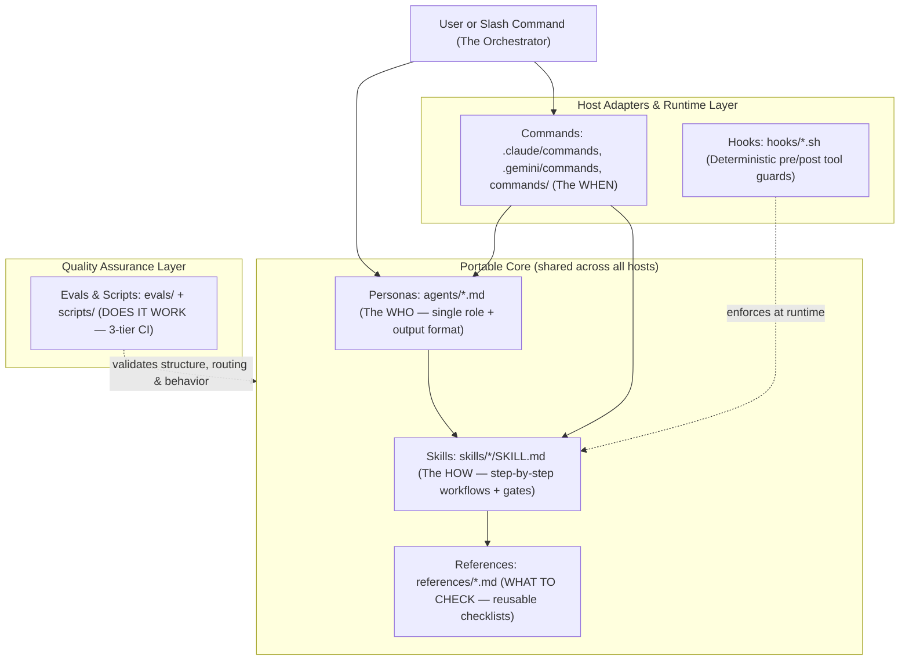
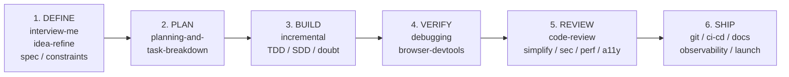

# Reading Guide: `agent-skills` (Addy Osmani)

> **Repository:** [`xavierxmorris/agent-skills-Addy-Osmani`](https://github.com/xavierxmorris/agent-skills-Addy-Osmani/tree/main) (fork of `addyosmani/agent-skills`, **v0.6.18**)  
> **Inventory:** 26 skills · 10 lifecycle commands · 5 specialist personas · 7 shared checklists · 3 hooks · 3-tier eval harness · 17 docs (~400 files total)

This repository is a production-grade engineering workflow pack for AI coding agents — encoding the habits of senior engineers (specs before code, TDD, five-axis review, anti-rationalization guards, and verifiable exit criteria) into portable Markdown files. Because it spans ~400 files across skills, multi-host adapters, hooks, and an automated eval suite, reading it top-to-bottom is a fast way to get lost.

Use this guide to extract maximum value in the time you have: start with the **15-minute shared core**, then pick the track that matches your goal.

---

## Mental Model Before You Open a Single File

Every contributor and adopter mistake in this repo comes from mixing up its **five composable layers** or violating its **orchestration rule**. Keep this map in mind while reading:

> [!IMPORTANT]
> **Two load-bearing rules that explain 80% of the repo's design:**
> 1. **The user (or a slash command) is the orchestrator.** Personas *never* invoke other personas — the only endorsed multi-persona pattern is parallel fan-out with a merge step (used by `/ship`).
> 2. **Process, not prose.** Skills are not reference docs; they are executable workflows with **Common Rationalizations** tables (rebuttals to the excuses agents invent to skip steps) and **Verification** checklists requiring concrete evidence.

---

## Start Here: The Shared 15-Minute Core

Read these four files in order regardless of your track. Together they give you the catalog, the routing model, and one concrete example of how a skill actually works.

| Order | File | Time | Why Read It | Key Takeaway |
|---:|---|---:|---|---|
| 1 | [README.md](https://github.com/xavierxmorris/agent-skills-Addy-Osmani/blob/main/README.md) | 4 min | High-level map of the 6-phase lifecycle, 10 commands, 26 skills, 5 personas, and host directory layout. | Understand the **Project Structure** table first: host-specific folders (`.claude-plugin/`, `.codex-plugin/`, `.gemini/`, `plugin.json`) are native discovery conventions, not duplicate copies of the skills. |
| 2 | [skills/using-agent-skills/SKILL.md](https://github.com/xavierxmorris/agent-skills-Addy-Osmani/blob/main/skills/using-agent-skills/SKILL.md) | 4 min | The meta-skill router and the 4 non-negotiable operating behaviors enforced across every session. | Shows the **Task → Skill decision tree** plus the anti-sycophancy rules (*Surface Assumptions*, *Manage Confusion Actively*, *Push Back When Warranted*, *Enforce Simplicity*). |
| 3 | [skills/test-driven-development/SKILL.md](https://github.com/xavierxmorris/agent-skills-Addy-Osmani/blob/main/skills/test-driven-development/SKILL.md) | 4 min | The canonical example of a mature skill end-to-end. | Internalize the anatomy by example: **When to Use (and NOT use)** → **Step-by-step process** → **Common Rationalizations table** → **Red Flags** → **Evidence-based Verification**. |
| 4 | [docs/comparison.md](https://github.com/xavierxmorris/agent-skills-Addy-Osmani/blob/main/docs/comparison.md) | 3 min | Honest side-by-side comparison against *Superpowers* (obra) and *Matt Pocock's skills*. | Clarifies *when* `agent-skills` is the right tool (full SDLC + human checkpoints + team standardization + CI evals) vs. when to borrow a la carte — and why you should never run two active routers at once. |

---

## Choose Your Track

Once you finish the 15-minute core, branch based on what you want to get out of the repository:

- **Want to roll this out on a real project or team?** → Go to **Track 1: Adopt** (~35–45 min)
- **Want to absorb the senior-engineering mental models & standout skills?** → Go to **Track 2: Philosophy & Engineering Craft** (~45–60 min)
- **Want to design, extend, hook, or evaluate your own skills?** → Go to **Track 3: Build & Evaluate Skills** (~50–65 min)

---

### Track 1: Adopt (Practitioners & Engineering Teams)

**Goal:** Go from "cool repo" to safely running these workflows on a greenfield or legacy codebase without drowning your context window or breaking team habits.

| Step | File | Time | Why Read It | Key Takeaway |
|---:|---|---:|---|---|
| 1 | [docs/getting-started.md](https://github.com/xavierxmorris/agent-skills-Addy-Osmani/blob/main/docs/getting-started.md) | 7 min | Covers universal setup, selective loading, working across sessions, and task-boundary restarts. | **Minimal starting trio:** `spec-driven-development`, `test-driven-development`, and `code-review-and-quality`. Living artifacts (`SPEC.md`, `tasks/plan.md`, `tasks/todo.md`) — not chat history — are the handoff between sessions. |
| 2 | [docs/adoption-guide.md](https://github.com/xavierxmorris/agent-skills-Addy-Osmani/blob/main/docs/adoption-guide.md) | 10 min | The most practical doc in the repo: contrasts **Greenfield (Day-1 full lifecycle)** vs. **Brownfield (4-phase verification-first rollout)**. | Never "big bang" a legacy codebase. In brownfield repos, start with `context-engineering` + characterization tests before refactoring; run two-speed adoption where legacy code gets safety nets and new features run `/spec → /ship`. |
| 3 | [references/definition-of-done.md](https://github.com/xavierxmorris/agent-skills-Addy-Osmani/blob/main/references/definition-of-done.md) | 4 min | Separates task-specific *Acceptance Criteria* ("did we build this thing?") from the standing *Definition of Done* ("is it ready?"). | Give your team and agents one fixed standing bar (Correctness, Quality, Integration, Docs, Ship-readiness) so "tests pass" stops being treated as a synonym for "done". |
| 4 | [skills/spec-driven-development/SKILL.md](https://github.com/xavierxmorris/agent-skills-Addy-Osmani/blob/main/skills/spec-driven-development/SKILL.md) | 6 min | The entry gate for any non-trivial feature. | A good agent spec declares not just objectives and commands, but explicit **boundaries** (Always / Ask First / Never) that keep agents from touching out-of-scope legacy surfaces. |
| 5 | [skills/constraint-driven-development/SKILL.md](https://github.com/xavierxmorris/agent-skills-Addy-Osmani/blob/main/skills/constraint-driven-development/SKILL.md) | 8 min | Solves the modern agent problem: *"the agent writes more code in an afternoon than anyone reads in a week."* | Produces `CONSTRAINTS.md` with rationalized thresholds and a **floor guard** that catches agents cheating to get green (`@ts-ignore`, `eslint-disable`, deleted assertions, skipped tests, lowered thresholds). |
| 6 | [docs/agents.md](https://github.com/xavierxmorris/agent-skills-Addy-Osmani/blob/main/docs/agents.md) | 6 min | Explains how the 5 specialist personas (`code-reviewer`, `security-auditor`, `test-engineer`, `web-performance-auditor`, `accessibility-auditor`) compose with commands. | Use direct persona invocation for one viewpoint; use `/ship` for parallel fan-out + merge; never build a "meta-orchestrator" persona that just paraphrases and routes. |
| 7 | *Your host setup doc* (see [Pick Your Host](#pick-your-host-adapter-matrix) below) | 5 min | Learn the exact install path and limitations for your daily tool. | Avoids the #1 onboarding surprise: knowing which hosts support `/spec` slash wrappers vs. direct skill names. |

---

### Track 2: Philosophy & Engineering Craft (Curated Skill Spotlight)

**Goal:** Study the highest-leverage skills in the catalog — the ones that codify rare, high-signal engineering judgment (from *Software Engineering at Google* and hard-won AI-agent failure modes) rather than generic checklists.

Read these **9 signature skills** in order of the problem they solve:

| # | Signature Skill | Time | Engineering Principle / Pattern Encoded | Why It's Worth Studying |
|---:|---|---:|---|---|
| 1 | [interview-me](https://github.com/xavierxmorris/agent-skills-Addy-Osmani/blob/main/skills/interview-me/SKILL.md) | 6 min | **Pre-spec intent extraction** (Hypothesis + Confidence % + one question at a time with an attached `GUESS`) | Stops agents from building the conventional thing users ask for ("a dashboard") instead of what they actually need ("a consolidated list"). Requires an explicit user restate before any tool runs. |
| 2 | [constraint-driven-development](https://github.com/xavierxmorris/agent-skills-Addy-Osmani/blob/main/skills/constraint-driven-development/SKILL.md) + [floor-guard.md](https://github.com/xavierxmorris/agent-skills-Addy-Osmani/blob/main/skills/constraint-driven-development/references/floor-guard.md) | 8 min | **Mechanical quality bars & anti-gaming floor guards** (Written → Scripted → Tool-backed escalation) | Recognizes that prose guidelines evaporate when sessions end. Introduces a diff-only floor guard that blocks agents from silencing linters or weakening tests to pass CI. |
| 3 | [context-engineering](https://github.com/xavierxmorris/agent-skills-Addy-Osmani/blob/main/skills/context-engineering/SKILL.md) | 6 min | **Context packing, progressive disclosure & Restartable Session Boundaries** | Explains why "load all skills at once" degrades agent quality, what actually belongs in project rules files, and how to cleanly hand off work across fresh sessions (including external harness / Ralph-loop boundaries). |
| 4 | [source-driven-development](https://github.com/xavierxmorris/agent-skills-Addy-Osmani/blob/main/skills/source-driven-development/SKILL.md) | 6 min | **DETECT → FETCH → IMPLEMENT → CITE** + prompt-injection retrieval hygiene | Eliminates stale-training-data hallucinations by grounding framework APIs in official version-matched docs, requiring deep-link citations, explicitly flagging `UNVERIFIED` code, and treating fetched pages as untrusted data. |
| 5 | [doubt-driven-development](https://github.com/xavierxmorris/agent-skills-Addy-Osmani/blob/main/skills/doubt-driven-development/SKILL.md) | 7 min | **CLAIM → EXTRACT → DOUBT → RECONCILE → STOP** (fresh-context adversarial review) | Solves in-session confirmation bias: strips the agent's own reasoning, sends only `ARTIFACT + CONTRACT` to a fresh-context reviewer biased to *disprove*, detects "doubt theater", and offers explicit cross-model escalation. |
| 6 | [debugging-and-error-recovery](https://github.com/xavierxmorris/agent-skills-Addy-Osmani/blob/main/skills/debugging-and-error-recovery/SKILL.md) | 5 min | **5-step triage** (Reproduce → Localize → Reduce → Fix → Guard) & Stop-the-Line rule | Forces agents out of the "guess-and-patch" loop by requiring a minimal reproduction and a regression guard test before declaring a bug fixed. |
| 7 | [code-review-and-quality](https://github.com/xavierxmorris/agent-skills-Addy-Osmani/blob/main/skills/code-review-and-quality/SKILL.md) | 6 min | **Google Eng Practices**: Five-axis review, ~100-line change sizing, `Nit:` / `Optional:` / `FYI:` severity labels | Teaches both humans and agents how to calibrate review feedback and split oversized diffs so code health monotonically improves. |
| 8 | [code-simplification](https://github.com/xavierxmorris/agent-skills-Addy-Osmani/blob/main/skills/code-simplification/SKILL.md) | 5 min | **Chesterton's Fence** & **Rule of 500** (behavior-preserving simplification) | Prevents agents from deleting load-bearing weirdness they don't understand; pairs with `hooks/simplify-ignore.sh` to physically mask untouchable performance-critical blocks. |
| 9 | [api-and-interface-design](https://github.com/xavierxmorris/agent-skills-Addy-Osmani/blob/main/skills/api-and-interface-design/SKILL.md) & [deprecation-and-migration](https://github.com/xavierxmorris/agent-skills-Addy-Osmani/blob/main/skills/deprecation-and-migration/SKILL.md) | 8 min | **Hyrum's Law**, **One-Version Rule**, **Code-as-Liability**, compulsory vs. advisory deprecation | The two most distinctively "Staff Engineer" skills in the pack — treating public interfaces as permanent contracts and legacy code as a liability to actively retire rather than endlessly wrap. |

> [!TIP]
> **Pattern to notice across all 9 skills:** Jump straight to the **Common Rationalizations** and **Red Flags** sections of any skill you skim. Those two tables distill the exact failure modes observed when running real LLMs on real repositories.

---

### Track 3: Build & Evaluate Skills (Architecture, Hooks & Eval Harness)

**Goal:** Understand how `agent-skills` is engineered as a maintainable, cross-host, CI-verified software project so you can author your own skills or contribute upstream.

| Step | File | Time | Why Read It | Key Takeaway |
|---:|---|---:|---|---|
| 1 | [docs/developer-onboarding.md](https://github.com/xavierxmorris/agent-skills-Addy-Osmani/blob/main/docs/developer-onboarding.md) | 6 min | Guided tour of the 5 layers, local verification loop (Node 24, zero `package.json` dependencies), and contribution paths. | Every validator CI runs (structure, links, versions, command parity, artifact paths, Tier-2 evals, hook tests) runs locally in seconds. |
| 2 | [docs/skill-anatomy.md](https://github.com/xavierxmorris/agent-skills-Addy-Osmani/blob/main/docs/skill-anatomy.md) | 8 min | The canonical format spec (`agentskills.io` frontmatter contract, 500-line budget, progressive disclosure, script conventions). | Read **"Write the Procedure, Not the Workaround"** carefully: citing WikiSkill (`arXiv:2608.27454`), encoding model-specific workarounds actively *harms* stronger models. Describe capabilities, never private tool names. |
| 3 | [docs/advanced-per-agent-configuration.md](https://github.com/xavierxmorris/agent-skills-Addy-Osmani/blob/main/docs/advanced-per-agent-configuration.md) | 6 min | How to add vendor runtime controls (`context: fork`, `disallowed-tools`, Gemini `max_turns`/model routing) without polluting portable frontmatter. | Keep top-level `SKILL.md` frontmatter strictly to the 6 spec fields; put vendor hints under `metadata` or generated per-agent adapter files. |
| 4 | [references/orchestration-patterns.md](https://github.com/xavierxmorris/agent-skills-Addy-Osmani/blob/main/references/orchestration-patterns.md) | 7 min | Catalog of the 5+ endorsed orchestration patterns (direct, single command, parallel fan-out, sequential user-driven, research isolation, Agent Teams) and 4 forbidden anti-patterns. | Explains *why* router personas, persona-calling-persona, sequential paraphrasing orchestrators, and deep persona trees fail (context loss + 2× token cost + lost human gates). |
| 5 | [evals/README.md](https://github.com/xavierxmorris/agent-skills-Addy-Osmani/blob/main/evals/README.md) | 10 min | Architecture of the **3-tier eval harness**: Tier 1 structural, Tier 2 deterministic TF-IDF routing (`--min-rank1 95`), Tier 3 headless behavioral evals (`execution` vs `dialogue` + pressure tests). | A red Tier-2 check almost always means **fix the skill's `description` vocabulary**, not the test prompt. Tier 3 tests time pressure, sunk-cost, and authority pressure to prove skills hold when agents are pushed to cut corners. |
| 6 | [hooks/SDD-CACHE.md](https://github.com/xavierxmorris/agent-skills-Addy-Osmani/blob/main/hooks/SDD-CACHE.md) & [hooks/SIMPLIFY-IGNORE.md](https://github.com/xavierxmorris/agent-skills-Addy-Osmani/blob/main/hooks/SIMPLIFY-IGNORE.md) | 8 min | Two clever, battle-tested Claude Code hook patterns worth stealing for any agent harness. | `sdd-cache` caches `WebFetch` docs on disk while strictly revalidating via HTTP `ETag`/`304 Not Modified`. `simplify-ignore` hashes protected code blocks into `BLOCK_<hash>` placeholders on `Read` and re-expands them on `Edit`/`Stop` so the model physically cannot rewrite perf-critical code. |
| 7 | [scripts/validate-skills.js](https://github.com/xavierxmorris/agent-skills-Addy-Osmani/blob/main/scripts/validate-skills.js) & [scripts/run-evals.js](https://github.com/xavierxmorris/agent-skills-Addy-Osmani/blob/main/scripts/run-evals.js) | 8 min | Skim the actual zero-dependency Node implementations of Tier 1 and Tier 2/3 validation. | Concrete reference implementation if you want to build CI quality gates and trigger-collision checks for your own organization's internal skill catalog. |
| 8 | [CONTRIBUTING.md](https://github.com/xavierxmorris/agent-skills-Addy-Osmani/blob/main/CONTRIBUTING.md) & [evals/skill-impact.md](https://github.com/xavierxmorris/agent-skills-Addy-Osmani/blob/main/evals/skill-impact.md) | 4 min | Governance rules, pre-flight duplicate-PR checks, and the append-only ledger for eval-rejected skill changes. | Shows how a mature open-source skill pack defends against catalog bloat and description drift. |

---

## Complete 26-Skill Quick-Lookup Map

Use this table as an index whenever you want to dive straight into a specific phase or engineering discipline.

### Meta
| Skill | Signature Mechanism | Read When... |
|---|---|---|
| [using-agent-skills](https://github.com/xavierxmorris/agent-skills-Addy-Osmani/blob/main/skills/using-agent-skills/SKILL.md) | Task → skill routing tree + 4 anti-sycophancy behaviors | Setting up a host without native routing or studying the pack's core behavioral rules. |

### Define
| Skill | Signature Mechanism | Read When... |
|---|---|---|
| [interview-me](https://github.com/xavierxmorris/agent-skills-Addy-Osmani/blob/main/skills/interview-me/SKILL.md) | One-question-at-a-time + `GUESS` + confidence % to ~95% | The ask is vague or conventional and you want to uncover true intent before writing a spec. |
| [idea-refine](https://github.com/xavierxmorris/agent-skills-Addy-Osmani/blob/main/skills/idea-refine/SKILL.md) | Divergent/convergent idea exploration (with `frameworks.md`, `examples.md`, `refinement-criteria.md`) | You have a rough concept and want structured variants before locking into one design. |
| [spec-driven-development](https://github.com/xavierxmorris/agent-skills-Addy-Osmani/blob/main/skills/spec-driven-development/SKILL.md) | PRD with objectives, commands, structure, testing & 3-tier boundaries | Starting any non-trivial project or feature (`SPEC.md` before code). |
| [constraint-driven-development](https://github.com/xavierxmorris/agent-skills-Addy-Osmani/blob/main/skills/constraint-driven-development/SKILL.md) | 4-question defaults interview + `CONSTRAINTS.md` + `floor-guard` | No quality bar is written down or agents keep weakening checks to get green. |

### Plan
| Skill | Signature Mechanism | Read When... |
|---|---|---|
| [planning-and-task-breakdown](https://github.com/xavierxmorris/agent-skills-Addy-Osmani/blob/main/skills/planning-and-task-breakdown/SKILL.md) | Dependency-ordered atomic tasks (`tasks/plan.md` + `tasks/todo.md`) | Turning an approved spec into independently verifiable work units. |

### Build
| Skill | Signature Mechanism | Read When... |
|---|---|---|
| [incremental-implementation](https://github.com/xavierxmorris/agent-skills-Addy-Osmani/blob/main/skills/incremental-implementation/SKILL.md) | Thin vertical slices: implement → test → verify → commit | Any change spanning multiple files or tasks. |
| [test-driven-development](https://github.com/xavierxmorris/agent-skills-Addy-Osmani/blob/main/skills/test-driven-development/SKILL.md) | Red-Green-Refactor, 80/15/5 pyramid, DAMP over DRY, Beyoncé Rule | Implementing logic, fixing bugs, or writing characterization tests in legacy code. |
| [context-engineering](https://github.com/xavierxmorris/agent-skills-Addy-Osmani/blob/main/skills/context-engineering/SKILL.md) | Rules hygiene, context packing, restartable session handoffs | Output quality degrades mid-session or you are structuring project rules / multi-session loops. |
| [source-driven-development](https://github.com/xavierxmorris/agent-skills-Addy-Osmani/blob/main/skills/source-driven-development/SKILL.md) | DETECT → FETCH → IMPLEMENT → CITE + prompt-injection hygiene | Writing framework/library code where version-accurate, cited APIs matter. |
| [doubt-driven-development](https://github.com/xavierxmorris/agent-skills-Addy-Osmani/blob/main/skills/doubt-driven-development/SKILL.md) | CLAIM → EXTRACT → DOUBT → RECONCILE → STOP (fresh-context adversarial pass) | High-stakes, irreversible, security-sensitive, or unfamiliar-code decisions. |
| [frontend-ui-engineering](https://github.com/xavierxmorris/agent-skills-Addy-Osmani/blob/main/skills/frontend-ui-engineering/SKILL.md) | Component architecture, design-system discipline, responsive UI, WCAG 2.1 AA | Building or modifying user-facing web interfaces. |
| [api-and-interface-design](https://github.com/xavierxmorris/agent-skills-Addy-Osmani/blob/main/skills/api-and-interface-design/SKILL.md) | Contract-first design, Hyrum's Law, One-Version Rule, error semantics | Designing HTTP APIs, SDKs, or module boundaries (especially brownfield seams). |

### Verify
| Skill | Signature Mechanism | Read When... |
|---|---|---|
| [browser-testing-with-devtools](https://github.com/xavierxmorris/agent-skills-Addy-Osmani/blob/main/skills/browser-testing-with-devtools/SKILL.md) | Chrome DevTools MCP for live DOM, console, network, and perf verification | Testing or debugging anything that renders in a real browser. |
| [debugging-and-error-recovery](https://github.com/xavierxmorris/agent-skills-Addy-Osmani/blob/main/skills/debugging-and-error-recovery/SKILL.md) | Reproduce → Localize → Reduce → Fix → Guard + Stop-the-Line | Diagnosing failing tests, broken builds, or unexpected runtime behavior. |

### Review
| Skill | Signature Mechanism | Read When... |
|---|---|---|
| [code-review-and-quality](https://github.com/xavierxmorris/agent-skills-Addy-Osmani/blob/main/skills/code-review-and-quality/SKILL.md) | Five-axis review, ~100-line change sizing, severity labels (`Nit`/`Optional`/`FYI`) | Reviewing any diff before merge or tuning PR review standards. |
| [code-simplification](https://github.com/xavierxmorris/agent-skills-Addy-Osmani/blob/main/skills/code-simplification/SKILL.md) | Chesterton's Fence + Rule of 500 (preserve exact behavior) | Cleaning up working but overly complex code (especially legacy hotspots). |
| [security-and-hardening](https://github.com/xavierxmorris/agent-skills-Addy-Osmani/blob/main/skills/security-and-hardening/SKILL.md) | OWASP Top 10, auth/secrets hygiene, dependency audit, 3-tier boundaries | Touching user input, auth, storage, external integrations, or running a baseline audit. |
| [performance-optimization](https://github.com/xavierxmorris/agent-skills-Addy-Osmani/blob/main/skills/performance-optimization/SKILL.md) | Measure-first discipline, Core Web Vitals targets, profiling & bundle analysis | Investigating slowdowns or setting performance budgets. |
| [accessibility-engineering](https://github.com/xavierxmorris/agent-skills-Addy-Osmani/blob/main/skills/accessibility-engineering/SKILL.md) | WCAG 2.2 AA audit (`axe-core`/`pa11y` + mandatory manual keyboard/SR checks) | Auditing and remediating accessibility before shipping UI. |

### Ship
| Skill | Signature Mechanism | Read When... |
|---|---|---|
| [git-workflow-and-versioning](https://github.com/xavierxmorris/agent-skills-Addy-Osmani/blob/main/skills/git-workflow-and-versioning/SKILL.md) | Trunk-based dev, atomic commits, ~100-line diffs, commit-as-save-point | Always — establishes bisectable commit hygiene. |
| [ci-cd-and-automation](https://github.com/xavierxmorris/agent-skills-Addy-Osmani/blob/main/skills/ci-cd-and-automation/SKILL.md) | Shift Left, Faster is Safer, feature flags, automated quality gates | Designing or hardening build, test, and deployment pipelines. |
| [deprecation-and-migration](https://github.com/xavierxmorris/agent-skills-Addy-Osmani/blob/main/skills/deprecation-and-migration/SKILL.md) | Code-as-liability, compulsory vs. advisory deprecation, zombie-code removal | Sunsetting APIs/systems or migrating users off legacy paths. |
| [documentation-and-adrs](https://github.com/xavierxmorris/agent-skills-Addy-Osmani/blob/main/skills/documentation-and-adrs/SKILL.md) | Architecture Decision Records (ADRs) — document the *why*, timeless present tense | Recording architectural decisions before the context disappears. |
| [observability-and-instrumentation](https://github.com/xavierxmorris/agent-skills-Addy-Osmani/blob/main/skills/observability-and-instrumentation/SKILL.md) | Structured logs, RED metrics, OpenTelemetry tracing, symptom-based alerts | Instrumenting services *while building* (not bolted on after an incident). |
| [shipping-and-launch](https://github.com/xavierxmorris/agent-skills-Addy-Osmani/blob/main/skills/shipping-and-launch/SKILL.md) | Pre-launch checklist, feature flag lifecycle, staged rollouts, rollback plan | Preparing a production release (pairs with `/ship` persona fan-out). |

---

## Pick Your Host: Adapter Matrix & Real Gotchas

The 26 `SKILL.md` files are portable across hosts, **but slash commands, personas, and hooks are not**. Check your host's actual capabilities here before reading its setup guide:

| Host | Adapter / Path in Repo | Native Skills | Lifecycle Commands (`/spec`, `/build`, `/ship`) | Specialist Personas (`agents/`) | Hooks (`hooks/`) | Key Gotcha to Know Upfront | Setup Guide |
|---|---|---|---|---|---|---|---|
| **Claude Code** | `.claude-plugin/`, `.claude/commands/`, `hooks/` | Yes (plugin) | **Yes** (all 10; `/agent-skills:review` if colliding) | **Yes** (subagents + Agent Teams) | **Yes** (`sdd-cache`, `simplify-ignore`, `session-start`) | Fullest native integration. Plugin agents silently ignore `hooks`, `mcpServers`, and `permissionMode` frontmatter. | [README Quick Start](https://github.com/xavierxmorris/agent-skills-Addy-Osmani/blob/main/README.md#quick-start) |
| **GitHub Copilot (VS Code)** | Copied into `.github/skills/`, `.github/agents/` | Yes (as `/<skill-name>`) | **No** (optional manual `.github/prompts/*.prompt.md` aliases) | **Yes** — *must rename* to `*.agent.md` | No | Plain `*.md` agent files are silently ignored; short `/spec` wrappers never auto-appear unless you create `.prompt.md` aliases. | [docs/copilot-setup.md](https://github.com/xavierxmorris/agent-skills-Addy-Osmani/blob/main/docs/copilot-setup.md) |
| **GitHub Copilot CLI** | Root `plugin.json` (Agent Plugins 1.0.0) | Yes (`copilot plugin install`) | **No** (CLI expects `com.github.copilot/commands/`) | No automatic command fan-out | No | Root `plugin.json` takes precedence over `.claude-plugin/plugin.json`. Invoke skills by name or intent; `/spec` not appearing is expected. | [docs/copilot-cli-setup.md](https://github.com/xavierxmorris/agent-skills-Addy-Osmani/blob/main/docs/copilot-cli-setup.md) |
| **Antigravity CLI (`agy`)** | Root `plugin.json`, `commands/*.toml` | Yes (`agy plugin install`) | **Limited** (known TOML wrapper importer bug #445) | **Yes** (`agents/` registered) | No | Use namespaced skills directly (e.g. `/agent-skills:spec-driven-development`). Don't add YAML frontmatter to TOMLs — it breaks Gemini CLI. | [docs/antigravity-setup.md](https://github.com/xavierxmorris/agent-skills-Addy-Osmani/blob/main/docs/antigravity-setup.md) |
| **Gemini CLI** | `.gemini/commands/*.toml` | Yes (`gemini skills install`) | **Yes** (native TOML wrappers) | Separate `.gemini/agents/*.md` schema | No | Omit `temperature` for Gemini 3.x models (use `thinking_level` in Gemini CLI config instead). | [docs/gemini-cli-setup.md](https://github.com/xavierxmorris/agent-skills-Addy-Osmani/blob/main/docs/gemini-cli-setup.md) |
| **Cursor** | None checked in — sync to `.cursor/skills/` + `.cursor/rules/*.mdc` | Yes | No | **No** (paste in chat or distill to `.mdc`) | No | Never paste full `SKILL.md` bodies into `.cursor/rules/`. Known Cursor server bug (#494) when attaching skills via `/`; reference by name in plain text instead. | [docs/cursor-setup.md](https://github.com/xavierxmorris/agent-skills-Addy-Osmani/blob/main/docs/cursor-setup.md) |
| **Codex CLI** | `.codex-plugin/plugin.json`, `.agents/plugins/marketplace.json` | Yes (`@<skill-name>`) | **No** | No | No | Uses progressive disclosure natively — **do not** preload `using-agent-skills` into `AGENTS.md` (causes double routing). | [docs/codex-setup.md](https://github.com/xavierxmorris/agent-skills-Addy-Osmani/blob/main/docs/codex-setup.md) |
| **OpenCode / Windsurf / Command Code / Kiro / Others** | `npx skills add` or native skill folders | Yes | Varies (mostly direct skill invocation) | Varies | No | See [opencode-setup.md](https://github.com/xavierxmorris/agent-skills-Addy-Osmani/blob/main/docs/opencode-setup.md), [windsurf-setup.md](https://github.com/xavierxmorris/agent-skills-Addy-Osmani/blob/main/docs/windsurf-setup.md), [commandcode-setup.md](https://github.com/xavierxmorris/agent-skills-Addy-Osmani/blob/main/docs/commandcode-setup.md), [other-hosts.md](https://github.com/xavierxmorris/agent-skills-Addy-Osmani/blob/main/docs/other-hosts.md). | — |

> [!WARNING]
> **Two universal portability traps across hosts:**
> 1. **Don't double-route:** If your host natively discovers skills from YAML frontmatter descriptions (Claude Code, Codex, Copilot, Cursor, Antigravity, Gemini CLI), **do not** paste `using-agent-skills/SKILL.md` into an always-on rules file — it stacks a second router on top of the host's native router.
> 2. **Per-skill `npx skills add --skill <name>` gap (#361):** Single-skill installs copy only `skills/<name>/` and omit the repo-level `references/` folder (though recent release `0.6.18` began shipping synced skill-local copies under `skills/<name>/references/shared/` for linked checklists). Whole-repo/plugin installs remain the cleanest path.

---

## "Don't Read This First" Skip List (Save Hours)

To keep your reading focused, explicitly **skip** these directories on your first pass:

| Path to Skip | Why It's Safe to Skip | When You *Would* Open It |
|---|---|---|
| `AGENTS.md` and `CLAUDE.md` at repo root | **Trap:** These configure agents contributing *to this repository itself* — they are **not** templates to copy into your own project. | Only if you are opening a PR against `agent-skills`. |
| `skills/*/references/shared/*.md` | Generated synced copies of root `references/*.md` (maintained by `scripts/sync-shared-references.js`). Reading both is pure duplication. | Read the canonical 7 files in root [`references/`](https://github.com/xavierxmorris/agent-skills-Addy-Osmani/tree/main/references) instead. |
| `.claude/commands/`, `.gemini/commands/`, `commands/` | Thin prompt wrappers around existing skills/personas, mirrored 3× across hosts for parity. | Only inspect [`.claude/commands/build.md`](https://github.com/xavierxmorris/agent-skills-Addy-Osmani/blob/main/.claude/commands/build.md) (for `/build auto`) and [`.claude/commands/ship.md`](https://github.com/xavierxmorris/agent-skills-Addy-Osmani/blob/main/.claude/commands/ship.md) (for the canonical persona fan-out). |
| `evals/cases/*.json`, `evals/fixtures/`, `evals/plugin/` | ~180 files of test cases, synthetic code fixtures, and grader rubrics. | Only sample **one** pair (e.g. [`evals/cases/test-driven-development.json`](https://github.com/xavierxmorris/agent-skills-Addy-Osmani/blob/main/evals/cases/test-driven-development.json)) after reading `evals/README.md`. |
| All 11 `docs/*-setup.md` files | Host-specific installation recipes. | Read **only** the one setup doc for the tool you actually use. |
| `scripts/*-test.js` & `hooks/*-test.sh` | Unit and regression tests for the repo's own validators and hooks. | Only when modifying scripts or hooks in Track 3. |

---

## Suggested Reading Time Budgets

- **15 minutes (Executive Orientation):** Start Here Core (`README.md`, `using-agent-skills`, `test-driven-development`, `comparison.md`) + Skim the Pick Your Host matrix.
- **1 hour (Ready to Adopt on a Real Repo):** Core (15 min) + Track 1 Adopt (40 min) + your single host setup guide (5 min).
- **2 hours (Staff-Level Mastery):** Core (15 min) + Track 2 Signature Skills Spotlight (55 min) + Track 3 Architecture, Hooks & Evals (50 min).
